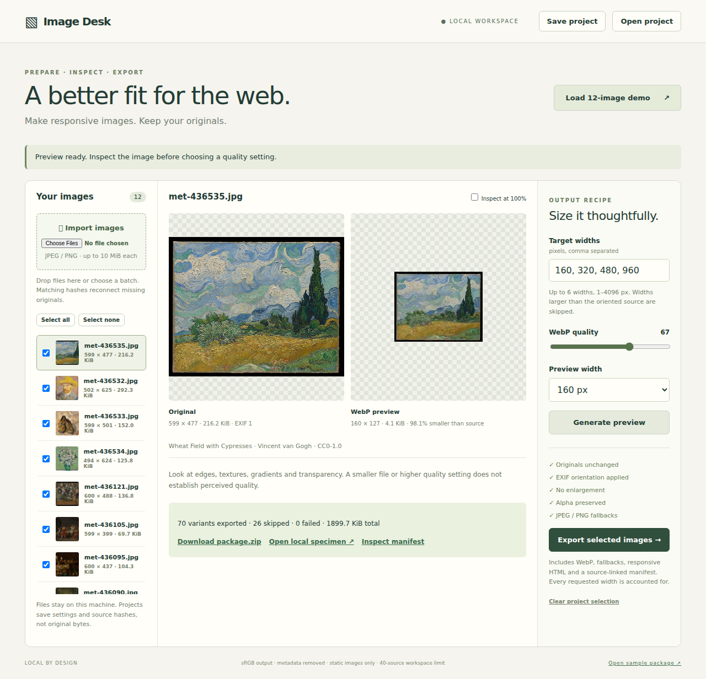

# Image Desk

A local browser workbench for turning JPEG and PNG originals into responsive image packages. Import a batch, compare an actual WebP encoding, choose widths and quality, then download images, responsive HTML and a source-linked manifest. Original files are never edited.

## Launch

Install **Node.js 22 or later**, then run:

```sh
./launch.sh
```

Open **http://127.0.0.1:4173**. The first launch installs locked npm dependencies and needs internet; subsequent launches and all image processing are local. No account, paid service or GPU is needed. `PORT=4180 ./launch.sh` selects another port. The server binds only to loopback; this is a single-user desktop tool, not a hosted service. Nothing is published.

Click **Load 12-image demo** to inspect real CC0 photographs of museum artworks, or **Import images** to choose your own JPEG/PNG files. The [sample specimen](demo/sample/index.html) also opens directly as a local file without starting the app.



## Prepare a package

1. Import a batch. Use checkboxes to choose which originals to export; click a row to inspect it. Identical bytes are deduplicated by SHA-256, even if filenames differ. Different images with the same name remain distinct.
2. Enter up to six target widths and set WebP quality. Select a preview width and click **Generate preview**. Both dimensions and encoded byte sizes are measured. **Inspect at 100%** enables full-size scrollable views; the default fits each image to its panel. A smaller file does not guarantee acceptable visual quality.
3. Click **Export selected images**. Download the ZIP and open the local specimen. Every requested width has two outcomes in `manifest.json`: WebP and JPEG (or PNG for transparent inputs). Widths above the oriented original are **skipped**, never silently enlarged. Failures include reasons. If every requested width is too large, no image is emitted; choose a smaller width and export again.
4. Unzip, keep the `images/` directory beside `index.html`, and copy a `<picture>` block into your site. Adapt `sizes` to the image's actual rendered width and write meaningful alt text. The specimen uses a 928px maximum width with 16px side padding. Supply attribution required by your own sources. Local imports have no assumed license; the manifest records that provenance was not supplied.

The package contains WebP variants, JPEG quality-85 opaque fallbacks or lossless PNG alpha fallbacks, HTML, a JSON manifest and integration notes. Full source hashes plus target widths prevent filename collisions. The manifest records requested settings, source provenance/hashes, oriented and raw dimensions, EXIF orientation, each output's size/hash/format, and whether a variant is larger than its source. Generated filenames are intentionally long for unambiguous identity. Exported originals are not included.

## Recovery and storage

Selections, active image and settings persist in browser local storage for this server origin. **Save project** downloads portable JSON; **Open project** restores it. JSON contains source identities/settings, **not image bytes**. Keep originals separately. Changing browser, port or computer can require opening that JSON.

The server retains byte-for-byte source copies in `.work/sources/`. On reopening a project, the server and browser require the exact expected SHA-256 before connecting an image. If files are missing or corrupted, import the exact originals again. A same-name image with different bytes is added separately and cannot satisfy the old reference. Reimporting a matching original repairs a corrupt server copy. Exports also check hashes before processing.

**Clear project selection** clears the browser project only. To reclaim all local server storage, first save your project and download wanted packages; stop the server, remove the generated `.work/` directory, then restart and reconnect originals. This deletes cached source copies and generated export packages, not files you originally imported. `.work/packages/` holds each export independently; packages are not automatically expired. Do not delete it while exports run. A failed or interrupted export can leave an incomplete directory; retry creates a fresh package. The tool does not watch or modify original file paths.

## Processing policy and limits

- Static JPEG and PNG only; content signatures are checked. Animated PNG and multipage images are rejected. GIF, WebP, AVIF, HEIC, SVG and TIFF imports are unsupported. Browser previews use WebP.
- EXIF orientations 1–8, including mirroring, are applied before sizing. Lanczos3 preserves aspect ratio to integer-pixel rounding. No enlargement; no cropping. Very small sources need appropriately small target widths.
- Sharp/libvips converts embedded profiles to sRGB; untagged inputs are assumed sRGB. Output EXIF, XMP, IPTC and ICC metadata are removed. Do not use this as a color-proofing or archival pipeline. Browsers, displays and source profiles can produce visible differences. Originals retain all original bytes and metadata in their local copies.
- Alpha is preserved in WebP and PNG fallback, never flattened onto a surprise background. JPEG fallback is used only for inputs without an alpha channel. Even fully opaque RGBA PNG inputs get PNG fallback. Checkerboards in the UI expose transparent regions.
- 10 MiB per source, 24 million decoded pixels, 40 unique sources per workspace/project, six target widths from 1–4096 px, WebP quality 1–100, and 100 MiB total encoded image bytes per package. Sources beyond the workspace count require a deliberate cleanup. Widths are deduplicated and sorted. Imports process one file per request; each batch continues after individual rejection and reports it.
- Exports and previews serialize to limit CPU/memory pressure; another request gets a busy error. Encoding is in-process and ZIP assembly uses memory. This is intended for modest local batches, not hostile traffic or large professional libraries. Disk storage grows with exports until you clean it. There is no quality metric or claim of perceptual equivalence.
- Chromium automation is covered at three viewports and two pixel densities. Resource choice is deliberately checked against all valid candidates, not one predicted width. Safari/Firefox and device-specific color handling have not been validated. No remote fonts, scripts or image requests are needed during use. Source attribution links are navigation links only.

## Real inputs, verification and reproduction

The committed corpus contains **12 real museum photographs of artworks**, not camera originals or synthetic scenes. This is a diverse illustration/texture corpus, not evidence of general photographic compression performance. [Sources](demo/sources.json) include original download URLs, object pages, CC0 policy links, byte sizes and SHA-256 hashes. Raw object API records in `demo/evidence/` preserve each `isPublicDomain: true` decision. Museum web-large JPEGs are acquisition inputs, unchanged after downloading; their resolutions are modest. The Met's [Open Access policy](https://www.metmuseum.org/policies/image-resources) makes designated public-domain images available under CC0. The artwork authors and titles remain in the sample manifest and captions.

```sh
python3 scripts/acquire.py       # Verify pinned originals; redownload any missing file and require its exact hash
npm run demo:build              # Regenerate the sample from those unchanged originals
npm test                       # Processing and failure controls
npx playwright install chromium
npm run test:browser            # Real UI/recovery/export, independent decoder checks, viewport/DPR tests
```

`npm ci` installs verification dependencies too. On minimal Linux installations, Playwright may require browser system libraries; follow its installation diagnostics. In environments where the default browser cache is unwritable, set `PLAYWRIGHT_BROWSERS_PATH` to a writable path for **both** installation and testing. Python 3 is needed only for acquisition/hash verification, not the application.

The independent decoder checks use Chromium's `createImageBitmap` and canvas, rather than the Sharp encoder, to decode **every** sample output and verify dimensions/aspect ratio. They compare downsampled pixels against all 12 originals to detect wrong-source or orientation mistakes. This numerical check is a correspondence check, not a visual-quality score. File signatures, output hashes/bytes, accounting and unchanged original hashes are checked separately. Labeled synthetic controls cover EXIF 1–8, alpha, duplicate names, small sources, invalid inputs, source loss/corruption, hash mismatch and size increase. Synthetic tests do not substitute for the real-image workflow.

See [validation results](results/README.md) for measured counts and limitations, and [design references](docs/references.md) for the primary documentation and existing implementation considered.
