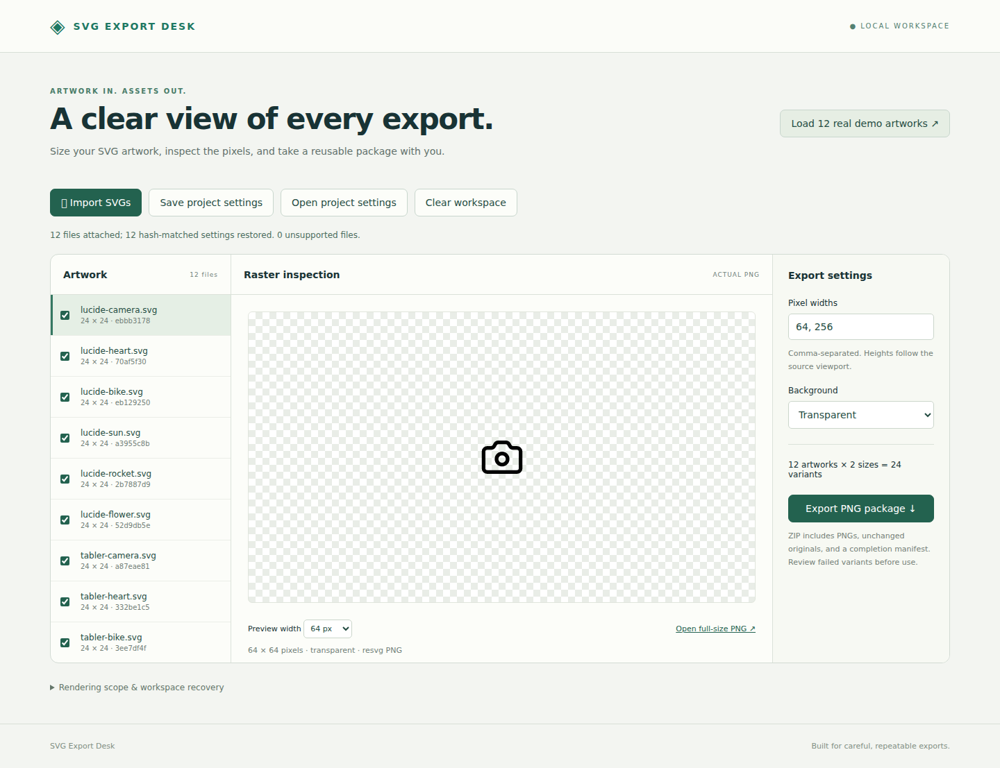

# SVG Export Desk

A local browser workbench for turning static SVG artwork into dimensioned PNG packages. Select artwork, choose pixel widths and a background, inspect actual resvg PNGs, and download a ZIP containing outputs, byte-identical originals, and a per-variant manifest.

## Launch

Install Node.js 22 or newer, then run:

```sh
./launch.sh
```

Open **http://127.0.0.1:4173**. The first launch installs locked npm dependencies (internet needed); subsequent operation is local. The server binds only to loopback. No account, API key, browser extension, or cloud service is needed. Set `PORT` to change the port. Stop with Ctrl-C.

## Try the real demo

1. Click **Load 12 real demo artworks**, or import/drop your own SVG files.
2. Select the artworks to export. Click a name to inspect its actual rasterized PNG.
3. Enter comma-separated pixel widths, then choose transparent or a solid background. Preview width chooses which requested size to inspect; **Open full-size PNG** opens the raster at native resolution. The checkerboard is not exported.
4. Click **Export PNG package**. Extract the ZIP and inspect `manifest.json`: `complete` means every requested variant exported; `partial` or `failed` identifies each failure and its reason. Identical filenames and repeated sizes get distinct indexed output names.
5. Reload, reattach originals, and check restored selections. **Save project settings** produces portable JSON; **Open project settings** replaces the workspace and requests source reattachment. SHA-256 must match before old selections are applied. Same name with changed bytes is a new, default-selected artwork, not a restored source. Source bytes are not stored in browser localStorage.

Sample browser-generated packages: [transparent](results/demo-transparent.zip), [solid](results/demo-solid.zip), and [portable settings](results/demo-project.json). The ZIP originals can be reattached to the portable project even though their package filenames are prefixed: matching uses bytes, not names.



## Rendering policy and limits

See [the explicit policy](docs/rendering.md). This is a deliberately limited static SVG tool, not a general browser SVG renderer or optimizer. It rejects text/fonts, images, CSS stylesheets/style attributes, scripts, animation, external resources and unsupported markup rather than fetching dependencies. Convert fonts to paths first. Original bytes are never modified; only an in-memory copy normalizes the viewport for rendering.

Each SVG is limited to 256 KiB, 2,000 elements, depth 32, and 100,000 characters per attribute. A workspace supports 24 sources and 48 requested variants per export. Width and resulting height must be at most 4,096 px; each output at most 8,388,608 pixels. Each render runs in a terminable worker with a five-second deadline. The service serializes operations and the browser queues its requests. Limits bound normal use; this is not an OS sandbox for hostile native-renderer inputs.

## Reproduce verification

```sh
npm ci
npm test
npx playwright install chromium
npm run test:browser
npm run verify:demo
```

If browsers are installed outside the default cache, set `PLAYWRIGHT_BROWSERS_PATH` consistently for install and both browser commands. Tests start their own loopback server on an ephemeral port. They overwrite generated demo packages/evidence with actual new execution results.

- [Browser execution evidence](results/browser-evidence.json): real import, preview, settings/reload/hash recovery, downloads and reopening PNGs.
- [Independent verification](results/independent-verification.json): pngjs decoding, dimensions, hashes, alpha and original-byte checks on 48 PNGs; native Chromium SVG-to-Canvas comparison against resvg.
- [Prospective comparison protocol](docs/comparison-protocol.json), written before comparison execution, and [visual comparison](results/renderer-comparison.png).
- `npm test`: labeled synthetic viewport, clipping, transparency, duplicate-name, unsupported-feature and limit controls, plus real fixture integrity checks.

The real corpus comprises twelve openly licensed icons from Lucide (ISC and inherited MIT notices) and Tabler (MIT). [Source records](fixtures/artwork/sources.json) retain pinned upstream commits, exact URLs, SHA-256 hashes and full license evidence beside the SVGs. `npm run acquire` redownloads exactly these revisions; no moving branch is used once the records exist. Acquisition needs internet; demo use does not. The icon corpus does not establish fidelity for arbitrary artwork, gradients, all clipping combinations or color-management workflows.

Tested browser/version and execution date are recorded in the evidence files. Firefox/Safari/mobile and private-browsing persistence have not been verified. localStorage can be cleared or denied; export a settings file for durable recovery. No undo/history, batch cancellation, color-profile control, or text shaping is provided. Server restarts leave originals on your disk and portable settings intact; browser recovery does not retain artwork bytes.

## Prior work and sources

This is workflow software using existing rendering technology, with no claim of renderer novelty. The viewport policy follows the [W3C SVG coordinate/viewport specification](https://www.w3.org/TR/SVG11/coords.html). [resvg](https://github.com/linebender/resvg) provides static rasterization; the exact `@resvg/resvg-js` version is locked and included in every export manifest. [Chromium](https://chromium.googlesource.com/chromium/src/+/main/third_party/blink/renderer/core/svg/) supplies the independent browser SVG implementation used in verification. Established desktop tools such as [Inkscape](https://inkscape.org/doc/inkscape-man.html) already offer SVG-to-PNG export; this tool concentrates on inspectable local batches and reusable settings.
