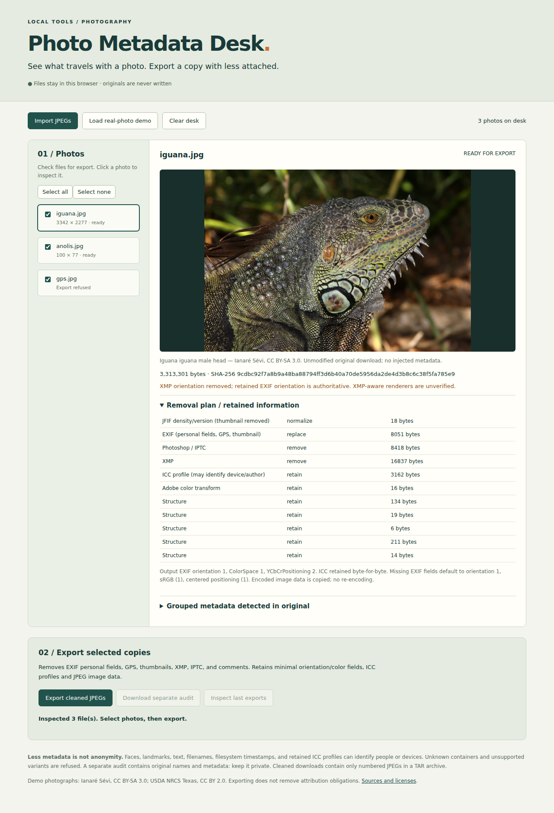

# Photo Metadata Desk

A local browser workbench for inspecting embedded JPEG metadata and explicitly exporting cleaned copies. Originals are never written. This is a metadata reduction tool, not an anonymity guarantee.

## Launch

Requires Node.js 22+, npm, Python 3, and a modern browser. From this directory:

```sh
npm start
```

Open **http://127.0.0.1:18766**. First launch installs the pinned browser metadata reader if absent and downloads three hash-checked licensed photographs (about 5.6 MiB total). Later launches verify the cached downloads. No account or paid service is required. For offline use with your own photos after installing dependencies, run `python3 scripts/serve.py` directly. The server binds only to loopback, serves explicit static routes, and accepts no uploads. Processing and audit creation happen in the browser; imported images are not sent to the server or stored between reloads.

1. **Load real-photo demo** or **Import JPEGs**. Click a filename and expand **Grouped metadata** to inspect camera details, dates, GPS, and other detected groups. Each supported photo has an orientation-aware preview and a container-level removal plan.
2. Check the files to export. The demo has two exportable photographs and one real GPS photograph whose **MPF multi-picture format is deliberately refused**. It remains inspectable; this project does not claim successful cleaning of that real GPS example.
3. **Export cleaned JPEGs** downloads `cleaned-photos.tar`. Extract it with your archive utility or `tar -xf cleaned-photos.tar`. It contains only `clean-001.jpg`, `clean-002.jpg`, etc. Same-name inputs cannot collide within an archive. Every selected file is shown as exported or explicitly failed. A new batch restarts numbering; extract separate batches to separate folders.
4. **Download separate audit** saves a private before/after JSON with original names, source/output SHA-256, detected metadata, container actions, failures, and warnings. It is excluded from the image archive. **Inspect last exports** replaces the desk with cleaned outputs; you can also import the extracted JPEGs normally. Save the audit before clearing/reloading if needed.



The screenshot contains Ianaré Sévi’s *Iguana iguana male head*, [CC BY-SA 3.0](https://creativecommons.org/licenses/by-sa/3.0/); image resized for display. See [provenance.json](provenance.json) for attribution, original URLs, license evidence, expected metadata, transformations, and SHA-256 for each demo. Keep those credits with redistributed demo derivatives; removing embedded attribution does not cancel license obligations.

## Exact removal policy: `jpeg-allowlist-v1`

| Container / field | Behavior |
| --- | --- |
| EXIF APP1, including duplicate containers | Remove entire payload: camera/owner/serial/time fields, GPS, MakerNotes, user comments, IFD1 thumbnail, padding and private fields. Write a fresh fixed-size EXIF block containing only Orientation, YCbCrPositioning, ColorSpace and the required ExifIFD pointer. |
| Orientation | Preserve IFD0 values 1–8, including mirrors. Reject conflicting duplicate values in one IFD or across containers; identical duplicates collapse. Missing value defaults to 1. Pixel samples are not rotated or re-encoded. |
| EXIF color | Preserve ColorSpace 1 or 65535 (the latter requires ICC), and YCbCrPositioning 1 or 2. Missing values default to sRGB (1) and centered (1); these defaults are explicitly labeled, not claimed as original tags. Nonstandard EXIF calibration fields are refused. |
| Standard and extended XMP APP1 | Remove entire containers. EXIF controls orientation. A detected `tiff:Orientation` spelling produces an explicit warning; arbitrary XMP namespaces/semantics are not interpreted. Appearance in XMP-driven software is unverified. |
| Photoshop APP13 / IPTC | Remove entire Photoshop resource container, including IPTC, Photoshop previews and editing/print instructions. Other APP13 signatures are refused. |
| COM, JFXX thumbnails | Remove all matching containers, including duplicates. |
| JFIF APP0 | Preserve its version, units and density; set thumbnail dimensions to zero and remove thumbnail pixels. Duplicate or malformed JFIF refused. |
| ICC APP2 | Retain all ICC profile bytes. Check chunk sequence/count, declared size and `acsp` signature. Profiles may contain author/device names, timestamps, copyright or other identifying text. No claim of complete ICC semantic validation. |
| Adobe APP14 | Retain the 12-byte Adobe version/flags/color-transform payload. Unknown length/transform refused. |
| JPEG structure | Copy DQT, DHT, DRI, SOF0/SOF2, SOS and entropy-coded bytes (including restart markers) without re-encoding. Normalize SOI/EOI. |
| Everything else | Refuse export: unknown APP containers, MPF/MPO, JUMBF, lossless/arithmetic/12-bit/CMYK JPEG, non-JPEG formats, trailing data/concatenated images, metadata between scans, malformed lengths, and unsupported frame markers. |

Only 8-bit grayscale or three-component baseline/progressive JPEG is supported. The parser is a container policy checker, not a full JPEG entropy validator. A structurally accepted but corrupt compressed stream may still fail a decoder. Metadata listing uses ExifReader independently of the cleaner; it can collapse duplicates or fail to interpret fields. Cleaning removes entire containers regardless of whether their fields appeared in the listing. “No tags found” is never presented as proof of privacy.

## Limits and appearance

20 MiB per file, 24 megapixels per supported image, 10 files and 60 MiB of source bytes per desk. Unsupported files are listed with a reason and no rendered preview. Work is in memory on the main browser thread; large batches can pause the interface and use several times their source size in memory. Refresh/clear discards imported buffers and audit state. Browser download behavior, filesystem permissions and OS timestamps are outside the tool’s control.

Visible faces, landmarks, license plates, text, steganography, image fingerprints and encoder characteristics remain. Retained profiles and structural information can be identifying. Source names are only in the separate audit, but renamed downloads, extraction paths and filesystem timestamps can still reveal context. Archives use neutral names and zero timestamps internally. There is no universal privacy protection and no automatic publishing.

Appearance has been checked with **Chromium** and **sharp/libvips**, comparing full-resolution decoded sRGB bytes after applying EXIF orientation, with zero tolerance. This tests the declared renderers, not all color-managed applications or physical displays. Photoshop print settings, XMP rendering instructions and exotic color metadata are outside that promise. ICC profiles are retained byte-for-byte. Firefox and Safari have not been tested.

## Reproduce verification

```sh
npm ci
python3 scripts/acquire.py
npx playwright install chromium
npm test
```

Verification additionally requires Perl for the pinned vendored ExifTool. On minimal Linux hosts, Playwright may need OS browser libraries installed by the host administrator. To use an alternate browser cache, set `PLAYWRIGHT_BROWSERS_PATH` consistently for install and tests.

- `tests/core.test.js`: real licensed inputs, explicit MPF refusal, eight orientation controls, progressive JPEG, GPS, IPTC, XMP, COM, EXIF/JFIF/JFXX thumbnails, duplicate containers, duplicate tags in one IFD, and conflicting/malformed refusal cases.
- `tests/browser.js`: real import/inspection/selection/download/reopen, mixed success/failure, same-name inputs, separate audit, full ten-file desk, all eight oriented previews, extracted archives containing only unique JPEGs, and Chromium canvas byte comparisons.
- `scripts/verify.js`: no production cleaner imports. A separate marker/TIFF whitelist plus **ExifTool `-G1 -a -n`** verifies outputs; compares encoded image-data and ICC hashes, original hashes, and **sharp/libvips** auto-oriented sRGB bytes. It checks actual browser downloads as well as direct cleaner outputs.

Generated media, archives and private audits stay in ignored `data/`. Regenerating controls overwrites only those explicitly synthetic control files. Real downloads are never rewritten on hash mismatch. [results/verification.json](results/verification.json) and [results/browser.json](results/browser.json) retain ordinary verification evidence; [results/tests.log](results/tests.log) contains test output. No test implies that untested formats are safe.

## Existing work

This project makes no novelty claim. It combines a narrow browser workflow with established metadata tooling. [ExifTool’s JPEG definitions](https://github.com/exiftool/exiftool/blob/master/lib/Image/ExifTool/JPEG.pm) document the many distinct APP containers; [ExifReader](https://github.com/mattiasw/ExifReader) supplies grouped inspection; [ExifTool](https://github.com/exiftool/exiftool) supplies an independent metadata oracle; [sharp](https://sharp.pixelplumbing.com/) supplies an independent renderer. The [exif-samples JPEG README](https://github.com/ianare/exif-samples/blob/master/jpg/README) documents the anolis derivative used here. The scope is intentionally smaller than ExifTool’s editing capabilities.
