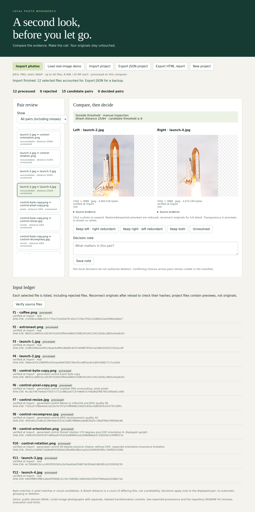

# Photo duplicate review

A local browser workbench for comparing photos and saving explicit pairwise retention decisions. It never deletes or modifies originals. Files selected in the browser are sent only to a loopback server on your computer; the server analyzes in memory and does not save uploads.

## Launch

Install Node.js 22 or newer, then run:

```sh
./launch.sh
```

Open **http://127.0.0.1:4317**. The first launch installs the locked npm dependencies (internet required); later launches and the bundled demo work offline. Stop with Ctrl-C. Use the same hostname and port to recover the same browser storage. `PORT=4320 ./launch.sh` changes the port and therefore the browser storage origin.

1. Click **Load real-image demo**, or **Import photos** to select your own files.
2. Choose a candidate pair; inspect images, filenames, dimensions, hashes and matching evidence. Click an image to expand it. Change **Show** to **All pairs** to inspect possible misses. In the demo, compare `launch-2.jpg` with `launch-4.jpg` in this view: this genuine related pair is missed at the default threshold.
3. Choose **Keep left / right** (the other is marked redundant for this pair), **Keep both**, or **Unresolved**. Add a note. Choices save immediately; use **Save note** after editing a note alone.
4. Reload to recover the project. **Verify source files** reselects originals and marks each recorded source verified, changed, or missing by filename plus SHA-256. A renamed file is missing until restored to the recorded name. Same-name different-content inputs remain distinct records with different hashes.
5. Export **JSON project** for a portable backup, or **HTML report** for an offline, self-contained report with embedded previews, all pair evidence, decisions and source references. Import JSON to restore a project. Reports are inspectable, not signed attestations; import trusts recorded evidence and requires source reconnection to verify bytes.



## What the evidence means

| Evidence | Definition | What it does not establish |
|---|---|---|
| `bytes` | SHA-256 of original file bytes agrees | Which physical copy should be retained |
| `pixels` | SHA-256 of oriented decoded RGBA samples and dimensions agrees, but file bytes differ | Metadata, color profile or file encoding equivalence |
| `similar` | 64-bit horizontal dHash distance ≤ 8 | Identical content, interchangeability or a probability |
| `noncandidate` | Distance > 8 and neither exact test matches | That files are unrelated |

Every processed pair retains its evidence, including noncandidates, in exports. There are no transitive groups. Retention choices are pair-local: a photo can be marked redundant in one pair and kept in another. No deletion plan is generated. Inspect all decisions before acting outside the app.

Normalization uses the locked Sharp/libvips decoder: EXIF orientation is applied, embedded color profiles are converted to sRGB, and samples become 8-bit RGBA. The pixel hash includes width, height and the `RGBA8` domain tag; RGB values under zero alpha remain significant. High-bit-depth content loses precision, so pixel identity is only identity under this normalization. Metadata is excluded from pixel hashes. Perceptual hashing flattens transparency onto white, converts to grayscale, resizes to 9×8 with Lanczos3, and compares horizontal neighboring values. Color differences can be missed. JPEG exports/previews flatten transparency onto white; originals are unchanged. Preview thumbnails are reduced to at most 480×480; full originals are available only while connected in the current browser session.

## Inputs, persistence and limits

- JPEG, PNG and static WebP only; animated/multipage files are rejected. Unsupported, corrupt, oversized and decoder-warning inputs are listed as rejected.
- At most 40 inputs per project, 8 MiB per image and 20 million decoded pixels. An over-count batch is explicitly rejected as a whole; split it into projects. Processing is serial and all-pairs comparison is quadratic (at most 780 pairs).
- Browser IndexedDB holds metadata, previews and decisions, not original photos. Storage failures are reported as **NOT SAVED**. Clearing site data, private browsing and browser eviction can remove projects: export JSON backups. JSON imports are limited to 24 MiB and validated before replacing the active project.
- Files are identified by record ID, selected filename (or browser-provided relative path) and SHA-256. Browsers do not disclose absolute source paths. A verification selection checks the entire project: unselected files are marked missing. Identical content with identical names cannot establish the existence of two distinct physical copies.
- Rotation without EXIF, crops, changed viewpoint, framing, exposure and small details can produce misses or false candidates. This is not comprehensive duplicate detection. No face recognition, embedding model or cloud service is involved.
- Desktop Chromium is the exercised browser. Other modern browsers are not independently tested. The local server binds only to 127.0.0.1, restricts Host/Origin and serves only allowlisted app/demo files. Do not expose it as a network service.

## Real inputs and reproducibility

The bundled collection has six real photographs (coffee, astronaut portrait, and four NASA STS-135 launch views), plus six explicitly generated controls. [demo/manifest.json](demo/manifest.json) records download URLs, attribution, source/license evidence, SHA-256 and each control's transformation. The NASA images are identified as US public-domain works in their archival records; the scikit-image samples are public domain/CC0. NASA names and logos do not imply endorsement. See [demo/README.md](demo/README.md) for source details.

```sh
npm ci
npm run demo:acquire   # re-download originals and verify frozen hashes; regenerate controls
npm test              # exact identity, normalization, rejection, project validation
npm run evaluate      # frozen visual labels; writes results/evaluation.json
npx playwright install chromium
npm run test:browser   # actual browser import/review/reload/export/reconnect workflow
node scripts/check-package.js
```

In sandboxed environments, use `npm ci --cache /tmp/photo-npm`, `PLAYWRIGHT_BROWSERS_PATH=/tmp/photo-browsers npx playwright install chromium`, and `PLAYWRIGHT_BROWSERS_PATH=/tmp/photo-browsers npm run test:browser`. Browser binaries and dependencies are not tracked.

The controls regenerate using the pinned decoder version. Acquisition fails rather than accepting changed source bytes. No random seeds are needed: transforms and evaluation are deterministic. `demo/labels.json` is a frozen, agent-visually-reviewed set, not a human-annotated benchmark. Labels were assigned from visible photos before the six-image similarity evaluation. The threshold was not tuned to these labels.

## Observed evaluation

The frozen evaluation contains all 15 real-image pairs: one labeled near-match requiring review and 14 labeled nonmatches. **dHash found 0/1 real near-matches, with 0 false positives and 1 missed match.** Five of six original-to-transformation controls were found; the physical 90° rotation was missed. Exact-only matching found three of the seven total labeled positives; dHash found five. These are small, selected examples, not population accuracy estimates. Related views of the same event are not automatically labeled redundant. The real near-match remains accessible through **All pairs** for manual review.

[results/evaluation.json](results/evaluation.json) preserves every prediction, distance, label and error. Direct byte equality and direct decoded-array comparisons independently check the hash-based exact findings across every demo pair, and before/after frozen hashes check source preservation. The direct-array verifier shares the Sharp decoder with the app; it is not an independent decoder validation.

This uses established perceptual hashing techniques, not a novel duplicate-detection algorithm. Existing work includes [idealo/imagededup](https://github.com/idealo/imagededup), which provides hash-based candidate search, and [Sharp](https://sharp.pixelplumbing.com/), which provides decoding and orientation/color operations. The value here is the local, inspectable retention workflow and recoverable evidence.
