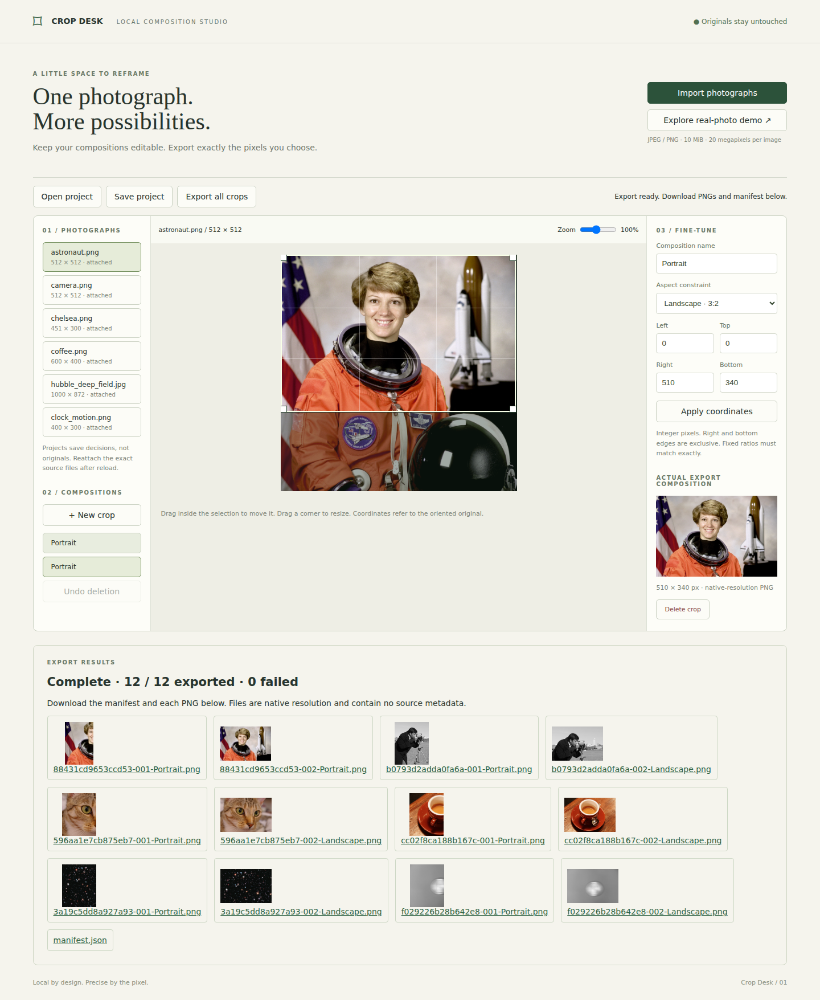

# Crop Desk

A local composition workbench: import photographs, keep multiple named crops, recover editable decisions, and export native-resolution PNGs with verifiable coordinates. Originals are never written.



## Launch

Install Python 3.10+ with `venv` support, then run:

```sh
./launch.sh
```

Open **http://127.0.0.1:8765**. First launch downloads the pinned Pillow dependency; subsequent operation is local. Use `./launch.sh --port 9000` for a different port. The server binds only to loopback. No accounts, API keys, or hosted services are required.

1. Choose **Explore real-photo demo**, or import your JPEG/PNG files.
2. Select a photograph and **New crop**. Name it; drag inside to move, or drag a corner to resize. Select a fixed ratio or freeform. Numeric bounds apply only when all four values are valid.
3. The composition preview shows the selected source region. Zoom changes only the editing view. **Delete crop** has session-local undo.
4. **Save project** downloads your decisions as JSON. Reload also restores decisions from this browser's local storage. Neither stores original bytes: reimport the exact originals to reattach. Different bytes create a separate source and cannot unlock saved selections. Opening a project replaces the current decisions, so save first.
5. **Export all crops** produces individual PNG download links and a separate `manifest.json`. Download all desired PNGs and the manifest. A missing original is an explicit failure; partial batches remain marked **INCOMPLETE**. Links are replaced by the next export. Names include the source hash prefix and request index so duplicate crop names do not collide within a batch.

The six demo photographs are included, along with [source URLs, license evidence, dimensions and SHA-256 hashes](demo/sources.json). [Sample exports](demo/exports/) contain portrait, landscape, and one-pixel edge crops for every photograph. These samples are generated by the pixel verification test; the browser demo creates editable portrait and landscape compositions.

## Pixel and recovery contract

- Coordinates are in the **EXIF-oriented source pixel space**. `[left, top, right, bottom)` includes left/top and excludes right/bottom. Positive width/height and fully in-bounds integer values are required. Numeric fractional values are rejected. Pointer deltas use JavaScript `Math.round`; fixed ratios use integer multiples of the reduced aspect numerator/denominator. Selecting a ratio shrinks the current rectangle, anchored at its top left. Corner resizing keeps the opposite corner fixed and uses horizontal motion to determine the exact ratio.
- Pillow decodes JPEG/PNG and applies EXIF transpose before selection. Grayscale and palette images expand to 8-bit RGBA. RGB gets opaque alpha; existing alpha is retained. CMYK, 16-bit PNG, animated images (including APNG), and other formats are rejected. This is not an animation editor.
- **Color policy:** retain decoded 8-bit sample values, ignore ICC profiles, interpret as sRGB. No ICC conversion or color-managed accuracy is promised. Tagged wide-gamut inputs can look different from color-managed viewers. JPEG decoding is inherently a conversion from compressed samples. No resampling occurs during export; only the on-screen preview is scaled.
- Output PNGs strip all EXIF, ICC, text, and other source metadata. Manifest records the processing policy, raw original SHA-256, oriented dimensions, exact crop rectangles, output dimensions/hashes and per-request status. Projects retain names, aspect constraints and rectangles. Source hash and decoded dimensions must agree before recovery.
- Source files are read into memory and sent only to the local server; the server does not save uploads. Project JSON and local storage contain filenames, hashes and decisions. Clear site data to remove saved decisions. Project files do not embed photographs.

## Limits

Desktop Chromium is exercised automatically; Firefox, Safari and mobile are unverified. Maximum 10 MiB and 20 megapixels per image, 30 sources per project, 100 crops per source, 40 megapixels of output per source per export, 1 MiB project JSON. Crops beyond the output budget are explicitly failed; reduce the number or size of crops and retry. Use modest batches: decoded previews and downloads remain in browser memory, and base64 adds overhead. The server processes one request at a time. There is no ZIP or automatic multi-download; download links deliberately let the user choose each output. Undo covers deletion within the current page session only. Local storage may be unavailable in privacy modes; save a project file. This is a single-user loopback tool, not a network service.

## Reproduce verification

```sh
.venv/bin/pip install -r requirements-test.txt
PLAYWRIGHT_BROWSERS_PATH=/tmp/crop-browsers .venv/bin/playwright install chromium
.venv/bin/python -m unittest discover -s tests -p 'test_core.py'
.venv/bin/python tests/browser.py
```

The browser test starts its own server on port 8766 and downloads outputs to ignored `.test-output/`. It exercises real file import, pointer move/resize, exact aspects, numeric rejection, duplicate names, deletion/undo, zoom, reload, project export/import, mismatch isolation, incomplete batches, successful export and standalone browser image viewing. OpenCV independently decodes all real-demo exports and compares every RGBA pixel to the source slice; Pillow is not used by the verifier. JPEG/OpenCV and Pillow both ultimately use libjpeg-family decoders, so this is independent decoding/cropping code, not independent JPEG codec ancestry. Synthetic controls are explicitly tests, not real photographs. Original hashes are checked before and after export.

Reacquire the six images with `.venv/bin/python scripts/acquire.py`. It downloads pinned scikit-image v0.25.2 files and fails if bytes differ from recorded SHA-256. See [provenance](demo/LICENSES.md).

## Design references

[Pillow ImageOps](https://pillow.readthedocs.io/en/stable/reference/ImageOps.html) documents EXIF transpose; [Pillow Image](https://pillow.readthedocs.io/en/stable/reference/Image.html) documents crop and mode conversion. [Cropper.js](https://github.com/fengyuanchen/cropperjs) is an established interactive cropping implementation, including canvas export. Crop Desk makes no novelty claim: its focus is multiple recoverable decisions and a separately verifiable native-pixel export manifest. The UI uses a small DOM-based selector; image processing is server-side so browser decoding does not define exported pixels.
